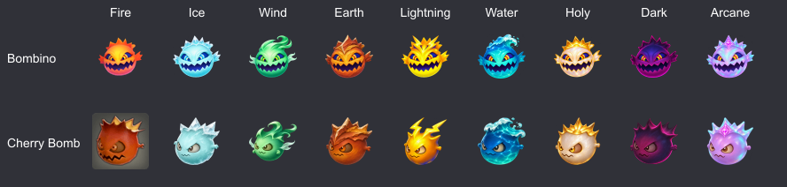

# Elemental bomb portraits

Bombino and Cherry Bomb keep their original Fire portraits. Each has eight alternate elemental portraits so players can tell their forms apart on the map. The 16 alternates are AI-assisted edits of the respective originals. The portraits and tokens ship with the module; no images are generated during play.

[Create an elemental Bomb](../variants/README.md) | [Credits & sources](credits.md#artwork)
